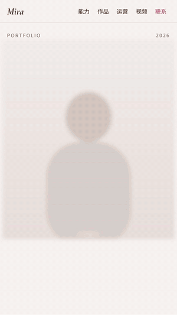

# offer-portfolio-site

把简历和作品集丢给 AI agent，得到两样东西：一份优化过的简历，和一个可以直接发给 HR 的个人作品集网站。

<p align="center"></p>

这是我自己求职时用的网站，后来整理成了一个 [Agent Skill](https://agentskills.io/)，任何支持 SKILL.md 的 agent 都能用。上面的预览用的是虚构的示例人物和示例图。

## 你会得到什么

**`resume-optimized.md`：优化后的简历**

- 逐句指出写得虚的地方：只写了“负责”没有结果、数字没有口径、套话、弱动词、经历和目标岗位对不上
- 只追问你答得上来的事实，不替你编数字、不升级职位
- 按目标岗位重写，开头列出最重要的几处改动和原因

**`index.html`：个人作品集网站**

- 单个文件，双击就能打开，拖到任何静态托管就能上线
- 手机优先，动效流畅，适合录屏展示
- 首屏：照片、名字、求职方向、一句话简介、三个关键数字
- 能力版图：细胞结构的能力图，点哪个展开哪个
- 作品卡：截图按原比例展示、可左右滑；每个作品下面有“你可能想问”，提前回答 HR 最想问的问题
- 视频样片、联系方式、简历下载

## 准备材料

| 材料 | 必需 | 说明 |
|---|---|---|
| 简历 | 是 | PDF、Word 或图片都行 |
| 作品集 / 项目集 | 推荐 | 越全越好，没写进简历的作品也可以放 |
| 个人照片 | 推荐 | 放在首屏 |
| 作品截图原图 | 推荐 | PDF 作品集里抠出来的图常常不清楚，最好另给原图 |
| 视频封面和链接 | 可选 | 有视频作品时放 |
| 简历 PDF | 可选 | 放在网站上供下载 |

只给简历也能生成，但网站会比较素：没有照片、没有作品截图、没有视频区。

## 安装

把 `offer-portfolio-site/` 这个文件夹放进你的 agent 的技能目录。

- **Claude Code**：复制到 `~/.claude/skills/`（所有项目可用）或项目里的 `.claude/skills/`
- **Claude 网页版 / 桌面端**：把 `offer-portfolio-site/` 文件夹压缩成 zip，在设置的技能（Skills）里上传
- **其他支持 Agent Skills 的工具**（Codex、Cursor 等）：放进该工具的技能目录，具体位置见各自文档

运行环境需要 Python 3。建议装上 Pillow 来压缩图片：`pip install pillow`，没装也能跑，只是网页文件会大一些。

## 使用

装好以后，把材料丢给 agent，说一句：

> 帮我优化简历，再做一个求职作品集网站

接下来大约三四轮对话：

1. 读完材料，给出简历诊断，追问缺的信息
2. 输出优化稿，你确认
3. 问网站需要的信息：显示什么名字、求职方向、公开哪些联系方式、哪些作品要放、截图里有没有要打码的内容
4. 给出网站骨架（首屏数字、能力版图、作品分区），你确认
5. 生成网站

之后想改哪里，截图圈出来告诉它就行。

## 上线

- **最快**：打开 [Netlify Drop](https://app.netlify.com/drop)，把 `index.html` 拖进去，就能拿到一个可以分享的网址
- 也可以用 GitHub Pages、Vercel 或任何静态托管

## 自己改样式

网站内容全部来自一个 `data.json`，模板不用动。字段说明和文案规则见 [`offer-portfolio-site/SKILL.md`](offer-portfolio-site/SKILL.md)，示例数据见 [`assets/example-data.json`](offer-portfolio-site/assets/example-data.json)。

配色可以在 `theme` 里改：底色、文字色、强调色。不指定的话，agent 会从你的照片里取色。

也可以跳过 agent，自己写好 `data.json` 后直接生成：

```bash
python3 offer-portfolio-site/scripts/build.py path/to/data.json -o index.html
```

## 常见问题

**国内打开网站，英文花体字没出来？**
字体来自 Google Fonts，国内可能加载不了，会自动换成系统自带字体，排版不受影响。

**网页文件太大？**
生成时加 `--max-width 900` 把图片压小一点，或者少放几张图。

**会编造经历吗？**
技能的规则要求只用你提供的事实，缺的信息会标成 `[待补充]` 并列出来。用之前还是请自己通读一遍。

## 目录

```
offer-portfolio-site/
├── SKILL.md                 # 技能说明：流程、文案规则、字段速查
├── references/
│   └── resume-guide.md      # 简历优化指南
├── assets/
│   ├── template.html        # 网站模板
│   └── example-data.json    # 示例数据
└── scripts/
    └── build.py             # 把 data.json 和图片打包成单个网页
```

## 协议

[MIT](LICENSE)。可以随便用、随便改，保留署名就好。
